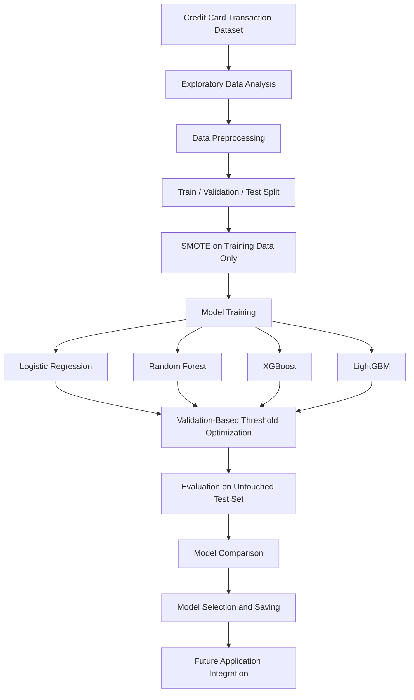
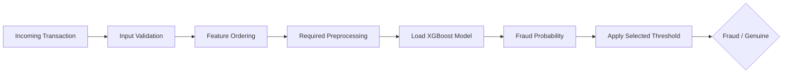

<div align="center">

# Credit Card Fraud Detection System

### An end-to-end machine learning pipeline for detecting fraudulent transactions in highly imbalanced data

**Best F1-Score: 0.8289 (XGBoost) &nbsp;|&nbsp; Best Precision: 0.9643 (Random Forest) &nbsp;|&nbsp; Best PR-AUC: 0.8204 (Random Forest)**

</div>

---

## Table of Contents

- [Overview](#overview)
- [Key Highlights](#key-highlights)
- [Results at a Glance](#results-at-a-glance)
- [Dataset](#dataset)
- [Project Workflow](#project-workflow)
- [Evaluation Methodology](#evaluation-methodology)
- [Exploratory Data Analysis](#exploratory-data-analysis)
- [Data Preprocessing and Imbalance Handling](#data-preprocessing-and-imbalance-handling)
- [Models Implemented](#models-implemented)
- [Model Performance](#model-performance)
- [Model Selection](#model-selection)
- [Threshold Optimization](#threshold-optimization)
- [Saved Model Artifacts](#saved-model-artifacts)
- [Inference Pipeline](#inference-pipeline)
- [Repository Structure](#repository-structure)
- [Tech Stack](#tech-stack)
- [Getting Started](#getting-started)
- [Team](#team)
- [Roadmap](#roadmap)
- [Disclaimer](#disclaimer)

---

## Overview

Credit card fraud detection is a difficult classification problem because fraudulent transactions make up only a tiny fraction of all transactions. A model that always predicts "genuine" can reach very high accuracy while catching no fraud at all, which is why accuracy alone is a misleading metric here.

This project builds and compares four classification models to separate:

| Label | Meaning |
|:-----:|---------|
| `0` | Genuine transaction |
| `1` | Fraudulent transaction |

The workflow covers exploratory data analysis, preprocessing, class-imbalance handling with SMOTE, model-specific threshold optimization on a validation set, and a leakage-aware final evaluation on an untouched test set.

---

## Key Highlights

- Analysis of a highly imbalanced, real-world credit card transaction dataset
- Four models trained and compared: Logistic Regression, Random Forest, XGBoost and LightGBM
- SMOTE applied to training data only, which reduces the risk of data leakage
- Validation-based threshold selection, applied consistently across all models
- Final metrics computed on an untouched test set that keeps its natural class distribution
- Evaluation with Precision, Recall, F1-score, ROC-AUC and PR-AUC rather than accuracy
- Model artifacts saved and ready for a future prediction application

---

## Results at a Glance

| Criterion | Best Model | Score |
|-----------|:----------:|:-----:|
| **F1-score** | XGBoost | **0.8289** |
| **Recall** | XGBoost | **0.7676** |
| **Precision** | Random Forest | **0.9643** |
| **ROC-AUC** | Random Forest | **0.9669** |
| **PR-AUC** | Random Forest | **0.8204** |

> **Current choice:** XGBoost is selected when F1-score (the balance between catching fraud and limiting false alarms) is the primary criterion. Random Forest remains a strong alternative when Precision or PR-AUC matters more.

---

## Dataset

The project uses the public [Credit Card Fraud Detection dataset on Kaggle](https://www.kaggle.com/datasets/mlg-ulb/creditcardfraud).

| Attribute | Value |
|-----------|-------|
| Transactions | 284,807 |
| Input features | 30 |
| Total columns | 31 (including target) |
| Target column | `Class` |
| Genuine class | `0` |
| Fraud class | `1` |

**Feature description**

| Feature | Description |
|---------|-------------|
| `Time` | Seconds elapsed between the first transaction and this transaction |
| `V1` to `V28` | Anonymized numerical features, already PCA-transformed in the source dataset |
| `Amount` | Transaction amount |
| `Class` | Target label (genuine or fraudulent) |

> **Note:** The original dataset is not included in this repository. Download it from Kaggle and place `creditcard.csv` in `Data/raw/`.

---

## Project Workflow



---

## Evaluation Methodology

To keep the evaluation consistent and free of leakage:

1. The data is split into training, validation and test sets.
2. SMOTE is applied only to the training set.
3. Each model is trained on the prepared training data.
4. The best threshold for each model is chosen on the validation set.
5. That threshold is then used to compute final metrics on the untouched test set.
6. All models are compared using the same procedure.

> The optimal threshold is model-specific and does not need to be numerically identical across models. What matters is that the selection procedure is the same and never touches the test set.

---

## Exploratory Data Analysis

The EDA stage examines:

- Dataset dimensions, data types and descriptive statistics
- Missing values and duplicate records
- Genuine vs. fraudulent class distribution
- Transaction amount and time distributions
- Individual feature distributions
- Correlation patterns among numerical features
- Potential outliers and unusual transaction patterns

These findings guide the preprocessing and modelling decisions.

---

## Data Preprocessing and Imbalance Handling

1. Separate input features from the target variable
2. Create training, validation and test sets
3. Apply feature scaling only where a model requires it
4. Handle class imbalance with SMOTE (Synthetic Minority Over-sampling Technique) on the training data only
5. Preserve the feature names and order expected by the trained model

SMOTE generates synthetic minority-class samples so models can better learn fraud patterns. Validation and test sets keep their original class distribution, so evaluation reflects the real, imbalanced problem.

Tree-based models (Random Forest, XGBoost, LightGBM) generally do not require standard feature scaling, but the inference pipeline must always match the preprocessing actually used to train the selected model.

---

## Models Implemented

| Model | Role in the Project |
|-------|---------------------|
| **Logistic Regression** | Baseline linear classifier |
| **Random Forest** | Tree ensemble for non-linear patterns |
| **XGBoost** | Gradient-boosted trees for structured data |
| **LightGBM** | Efficient gradient boosting for tabular data |

---

## Model Performance

Final results on the held-out test set, using each model's validation-selected threshold:

| Model | Precision | Recall | F1-score | ROC-AUC | PR-AUC |
|-------|:---------:|:------:|:--------:|:-------:|:------:|
| Logistic Regression | 0.0503 | **0.8803** | 0.0952 | 0.9665 | 0.6913 |
| Random Forest | **0.9643** | 0.5704 | 0.7168 | **0.9669** | **0.8204** |
| **XGBoost** | 0.9008 | 0.7676 | **0.8289** | 0.9634 | 0.8004 |
| LightGBM | 0.9174 | 0.7042 | 0.7968 | 0.9599 | 0.7114 |

*Bold = best value in that column.*

### Interpreting the results

- **XGBoost** has the highest F1-score, the best balance between Precision and Recall.
- **Random Forest** has the highest Precision (fewest false fraud alerts) and the highest PR-AUC, but misses more fraud (lower Recall).
- **Logistic Regression** catches the most fraud (highest Recall) but produces a very large number of false alerts, so its Precision and F1 are low at the selected threshold.
- **LightGBM** gives a strong Precision-Recall balance, though its F1-score is below XGBoost.

### Metric definitions

| Metric | What it tells you |
|--------|-------------------|
| **Precision** | Of the transactions flagged as fraud, how many were actually fraud |
| **Recall** | Of all real fraud, how much was detected |
| **F1-score** | Harmonic mean of Precision and Recall |
| **ROC-AUC** | Ranking quality across all thresholds |
| **PR-AUC** | Precision-Recall trade-off, especially informative for imbalanced data |

> Accuracy is deliberately not used as a selection criterion, because the genuine class dominates the dataset.

---

## Model Selection

XGBoost is the current selection when F1-score is the primary criterion. The choice reflects the trade-off between detecting fraud and limiting false alerts:

- **Prioritize catching fraud** (higher Recall): XGBoost
- **Prioritize fewer false alarms** (higher Precision): Random Forest

The right operating point ultimately depends on the cost of a missed fraud versus the cost of a false alert in a given business setting.

---

## Threshold Optimization

A classifier outputs a probability. A threshold converts it into a label:

```text
Predicted probability >= selected threshold  ->  Fraud
Predicted probability <  selected threshold  ->  Genuine
```

Instead of assuming `0.5` is optimal for every model, the best threshold is selected per model on the validation set and then applied to the test set. This lets each model operate at a suitable Precision-Recall trade-off while keeping the methodology consistent.

---

## Saved Model Artifacts

| File | Purpose |
|------|---------|
| `xgboost_model.pkl` | Serialized trained XGBoost classifier |
| `xgboost_threshold.pkl` | Selected XGBoost classification threshold |
| `feature_columns.pkl` | Expected input feature names and order |
| `scaler.pkl` | Scaling object, if required by the relevant pipeline |

> **Important:** Keep the model, threshold, feature order and preprocessing consistent. Do not apply `scaler.pkl` to XGBoost unless the saved model was actually trained with that scaling step.
>
> **Security:** Only load pickle files from trusted sources. Compatibility may depend on the Python and library versions used to create them.

---

## Inference Pipeline



**Example usage** (illustrative; adjust paths and preprocessing to match your training setup):

```python
import joblib
import pandas as pd

model = joblib.load("Models/xgboost_model.pkl")
threshold = joblib.load("Models/xgboost_threshold.pkl")
feature_columns = joblib.load("Models/feature_columns.pkl")

# `transaction` is a dict with the same input features used in training
X = pd.DataFrame([transaction])[feature_columns]   # enforce feature order

fraud_probability = model.predict_proba(X)[:, 1][0]
label = "Fraud" if fraud_probability >= threshold else "Genuine"

print(f"Fraud probability: {fraud_probability:.4f} -> {label}")
```

---

## Repository Structure

```text
Credit_Card_Fraud_Detection/
│
├── Data/
│   ├── raw/
│   │   └── creditcard.csv
│   └── processed/
│       ├── X_train.csv
│       ├── X_test.csv
│       ├── y_train.csv
│       ├── y_test.csv
│       ├── X_train_smote.csv
│       └── y_train_smote.csv
│
├── EDA/
│   ├── 01_Data_Understanding_and_EDA.ipynb
│   └── 02_Data_Preprocessing.ipynb
│
├── Models/
│   ├── 03_Logistic_Regression.ipynb
│   ├── 04_Random_Forest.ipynb
│   ├── 05_XGBoost.ipynb
│   ├── 06_LightGBM.ipynb
│   ├── xgboost_model.pkl
│   ├── xgboost_threshold.pkl
│   ├── feature_columns.pkl
│   └── scaler.pkl
│
├── README.md
├── requirements.txt
└── .gitignore
```

> This is the intended layout. Some generated datasets and model artifacts may be excluded from Git or kept locally. The original dataset is never committed.

---

## Tech Stack

| Area | Tools |
|------|-------|
| Language | Python |
| Data manipulation | Pandas, NumPy |
| Machine learning | Scikit-learn |
| Boosting frameworks | XGBoost, LightGBM |
| Imbalance handling | imbalanced-learn (SMOTE) |
| Visualization | Matplotlib, Seaborn |
| Serialization | Pickle, Joblib |
| Environment | Jupyter Notebook, VS Code |
| Version control | Git, GitHub |

---

## Getting Started

**1. Clone the repository**

```bash
git clone https://github.com/bhaviktalwar/Credit_Card_Fraud_Detection.git
cd Credit_Card_Fraud_Detection
```

**2. Create and activate a virtual environment**

```bash
python -m venv venv

# Windows
venv\Scripts\activate

# macOS / Linux
source venv/bin/activate
```

**3. Install dependencies**

```bash
pip install -r requirements.txt
```

**4. Add the dataset**

Download the Kaggle dataset and place the file at:

```text
Data/raw/creditcard.csv
```

**5. Launch Jupyter**

```bash
jupyter notebook
```

### Notebook execution order

| Step | Notebook |
|:----:|----------|
| 1 | `EDA/01_Data_Understanding_and_EDA.ipynb` |
| 2 | `EDA/02_Data_Preprocessing.ipynb` |
| 3 | `Models/03_Logistic_Regression.ipynb` |
| 4 | `Models/04_Random_Forest.ipynb` |
| 5 | `Models/05_XGBoost.ipynb` |
| 6 | `Models/06_LightGBM.ipynb` |

---

## Team

| Member | Contribution |
|--------|--------------|
| **Bhavik Talwar** | Exploratory data analysis, data preprocessing, Random Forest development |
| **Hardika** | Logistic Regression and Random Forest threshold-related work |
| **Gauravi** | XGBoost development |
| **Harsimrat** | LightGBM development |

### Collaboration workflow

Each member develops on an individual branch, and reviewed changes are merged into `main`.

```text
main
├── bhavik
├── hardika
├── gauravi
└── harsimrat
```

---

## Roadmap

- [ ] REST API for real-time transaction prediction
- [ ] Interactive frontend dashboard
- [ ] Transaction risk scores and prediction history
- [ ] Visual model-performance monitoring
- [ ] Database integration for transaction records
- [ ] Authentication and user management
- [ ] Cloud deployment
- [ ] Model drift monitoring and periodic retraining on reviewed data

---

## Disclaimer

This project is intended for educational and research purposes. Its predictions should not be treated as a definitive determination of fraud. A production-grade fraud detection system would require extensive validation, security controls, human review processes, monitoring and domain-specific safeguards.

---

<div align="center">

**Built as a collaborative machine learning project**

*Turning transaction data into actionable fraud-risk signals.*

</div>
